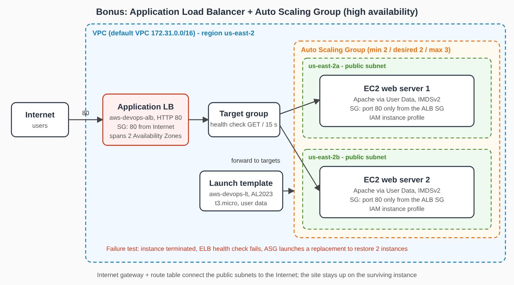

# AWS DevOps Assignment

**Student:** alexr &nbsp;|&nbsp; **Role:** Junior DevOps Engineer &nbsp;|&nbsp; **Module:** AWS Cloud Foundations

## Project overview
A small, secure, documented AWS environment for a static website. Another engineer can rebuild, troubleshoot and clean it up from this repository alone. Git/GitHub holds the code, EC2 + User Data serves the site, S3 stores objects, CloudFormation defines the infrastructure, IAM gives the instance its permissions, and CloudWatch + SNS provide monitoring.

## Architecture


Details: [docs/architecture.md](docs/architecture.md)

## AWS services used
EC2, EBS, VPC (subnet, internet gateway, route table), Security Groups, S3, IAM, CloudFormation, CloudWatch, SNS, AWS CLI / CloudShell.

## Repository layout
```
README.md  website/index.html  cloudformation/infrastructure.yaml
scripts/user-data.sh  scripts/user-data-asg.sh  scripts/git-workflow.sh
docs/{architecture.md,architecture.svg,architecture-bonus.svg,architecture-bonus.png,security.md,troubleshooting.md,aws-cli-commands.md}
screenshots/
```

## Prerequisites
- Own AWS account (test data only), an IAM user/role with permissions, AWS CLI v2 or CloudShell
- Git and a GitHub account; your public IP (`curl https://checkip.amazonaws.com`)
- An email address for alarm notifications

## Deployment steps
**A. Manual build (Tasks 3-9)**
1. Launch EC2: Amazon Linux 2023, t3.micro, default VPC or the CloudFormation VPC; paste `scripts/user-data.sh` into *Advanced details -> User data*; attach the IAM role; tag Owner/Project/Environment.
2. Security Group: HTTP 80 from `0.0.0.0/0`, SSH 22 from `<your-ip>/32`.
3. Create an S3 bucket, enable versioning, keep Block Public Access, upload 3 files, add tags.
4. Create the CloudWatch alarm (CPU > 70%, 5 min) with an SNS email topic and confirm the subscription.
5. Open `http://<public-ip>` and screenshot the page.

**B. CloudFormation lifecycle (Task 7)**
```bash
aws cloudformation validate-template --template-body file://cloudformation/infrastructure.yaml

aws cloudformation create-stack --stack-name aws-devops-cfn \
  --template-body file://cloudformation/infrastructure.yaml \
  --capabilities CAPABILITY_IAM \
  --parameters ParameterKey=Owner,ParameterValue="YOUR NAME" \
               ParameterKey=AdminCidr,ParameterValue=YOUR.IP.ADDR.ESS/32 \
               ParameterKey=AlertEmail,ParameterValue=you@example.com
aws cloudformation wait stack-create-complete --stack-name aws-devops-cfn   # evidence: CREATE_COMPLETE

# update used in this project: Environment dev -> test (console "Update stack", existing template).
# The same change from the CLI (all parameters kept, one changed):
aws cloudformation update-stack --stack-name aws-devops-cfn \
  --template-body file://cloudformation/infrastructure.yaml --capabilities CAPABILITY_IAM \
  --parameters ParameterKey=Owner,UsePreviousValue=true ParameterKey=AdminCidr,UsePreviousValue=true \
               ParameterKey=AlertEmail,UsePreviousValue=true ParameterKey=InstanceType,ParameterValue=t3.small
aws cloudformation wait stack-update-complete --stack-name aws-devops-cfn   # evidence: UPDATE_COMPLETE
```
Confirm the SNS subscription email, then screenshot the stack events.

## Git workflow used
`main` (stable) and `develop` (integration) with short feature branches merged into `develop`, then `main`. Commands in [scripts/git-workflow.sh](scripts/git-workflow.sh).

## Security approach
Least-privilege Security Group and IAM role, no keys in Git or on the instance, IMDSv2, encrypted EBS, private versioned S3. See [docs/security.md](docs/security.md).

## Monitoring approach
CloudWatch alarm on `CPUUtilization` > 70% for 5 minutes (one 300 s period) notifies an SNS email topic. 70% leaves headroom before saturation but ignores short spikes. The alarm state and the email are in `screenshots/`.

## Troubleshooting summary
Two cases follow *symptom -> test -> root cause -> fix -> verification* in [docs/troubleshooting.md](docs/troubleshooting.md).

## Cleanup procedure
```bash
aws s3 rm s3://<bucket-name> --recursive                       # also remove old versions (console: "Empty")
aws cloudformation delete-stack --stack-name aws-devops-cfn
aws cloudformation wait stack-delete-complete --stack-name aws-devops-cfn
# bonus: delete the ASG first (it terminates its instances), then the ALB, target group and launch template
aws autoscaling delete-auto-scaling-group --auto-scaling-group-name aws-devops-asg --force-delete
```
Then delete manually created resources (ALB, target group, launch template, EC2, Security Groups, S3 bucket, alarm, SNS topic, IAM role) and screenshot the empty console lists. Check **Billing -> Free tier** the next day.

## Results and lessons learned
- The update changed `Environment` from `dev` to `test`. Because names in the template depend on it, CloudFormation **replaced** several resources (VPC, subnet, security group, bucket, role, instance) instead of editing them in place, so the website got a new public IP. Replacement versus in-place update is visible in the stack events.
- A stop/start of the manual instance also changes its public IP (see troubleshooting case 2); an Elastic IP or DNS name would keep it stable.
- The S3 bucket name contains the AWS account ID, so it is not written in these docs.

## Bonus: Application Load Balancer + Auto Scaling Group


Built by hand in the console (default VPC, us-east-2). User data: [scripts/user-data-asg.sh](scripts/user-data-asg.sh), which prints the instance ID and zone on the page so load balancing is visible.

| Component | Configuration |
|---|---|
| Security groups | `aws-devops-alb-sg`: HTTP 80 from the Internet, outbound HTTP 80 only to the instance group. `aws-devops-asg-sg`: HTTP 80 only from `aws-devops-alb-sg` (no public SSH). |
| Launch template `aws-devops-lt` | Amazon Linux 2023, t3.micro, IAM instance profile, IMDSv2 required, user data, Owner/Project/Environment tags |
| Target group `aws-devops-tg` | Instances, HTTP 80, health check `GET /` every 15 s, healthy 2, unhealthy 2, timeout 5 s, success code 200 |
| ALB `aws-devops-alb` | Internet-facing, subnets in `us-east-2a` and `us-east-2b`, listener HTTP 80 forwards to the target group |
| ASG `aws-devops-asg` | Launch template `aws-devops-lt`, two subnets, ELB health checks, grace period 120 s, min 2 / desired 2 / max 3 |

**Result.** Both targets became `healthy` and repeated requests to the ALB DNS name were answered alternately by the two instances.

**Failure test.** One instance was terminated with `aws ec2 terminate-instances`. The site kept answering `200` from the surviving instance the whole time. The ASG logged "an instance was launched in response to an EC2 health check indicating it has been terminated or stopped" and started a replacement in the same zone. After about three minutes the replacement was `InService` and `healthy`, the old instance was gone, and the ALB served both instance IDs again.

**Notes.** The old instance stayed in *Terminating* while the ALB drained connections (default 300 s). A new instance needs about 1 to 2 minutes (Apache install) before it passes two health checks, so the grace period must cover that time. The instances sit in public subnets with public IPs for simplicity; in production they would use private subnets behind a NAT gateway.

## Evidence checklist
All items are saved in [`screenshots/`](screenshots/).

| Item | Screenshot |
|---|---|
| Repo and branches | `git-log-graph.png`, `github-branches.png` |
| Website (local and on EC2) | `website-local.png`, `ec2-website.png` |
| EC2 configuration | `ec2-details.png` |
| Security Group rules | `sg-rules.png` |
| IAM role and S3 read policy | `iam-role.png`, `iam-s3-policy.png` |
| S3 objects, versioning, Block Public Access | `s3-objects.png`, `s3-versions.png`, `s3-versioning.png`, `s3-block-public.png` |
| AWS CLI / CloudShell commands | `cloudshell-1.png` |
| CloudWatch alarm and SNS | `cloudwatch-alarm.png`, `cloudwatch-alarm-list.png`, `sns-subscription.png`, `alarm-email.png` |
| CloudFormation validate and create | `cfn-validate.png`, `cfn-create-command.png`, `cfn-create-complete.png`, `cfn-resources.png`, `cfn-outputs.png`, `cfn-website.png` |
| CloudFormation update | `cfn-update-complete.png`, `cfn-update-events.png`, `cfn-parameters.png` |
| CloudFormation delete (stack cleanup) | `cfn-deleted.png`, `cfn-deleted-list.png` |
| Troubleshooting 1 and 2 | `ts1-start.png`, `ts1-broken.png`, `ts1-fixed.png`, `ts2-broken.png`, `ts2-fixed.png` |
| Bonus: security groups, launch template | `bonus-sg-list.png`, `bonus-asg-sg-rules.png`, `bonus-alb-sg.png`, `bonus-launch-template.png`, `bonus-launch-template-advanced.png` |
| Bonus: target group and ALB | `bonus-target-group.png`, `bonus-tg-health.png`, `bonus-alb.png`, `bonus-tg-healthy.png`, `bonus-alb-balancing.png` |
| Bonus: Auto Scaling Group | `bonus-asg.png`, `bonus-asg-instances.png`, `bonus-asg-ec2-list.png`, `bonus-asg-cli.png` |
| Bonus: failed instance replaced | `bonus-failure-1.png`, `bonus-failure-2.png`, `bonus-failure-3.png`, `bonus-failure-4.png` |
| Diagrams | `docs/architecture.svg`, `docs/architecture-bonus.svg` |
| Final cleanup (every resource list empty) | `cleanup-final.png` |
