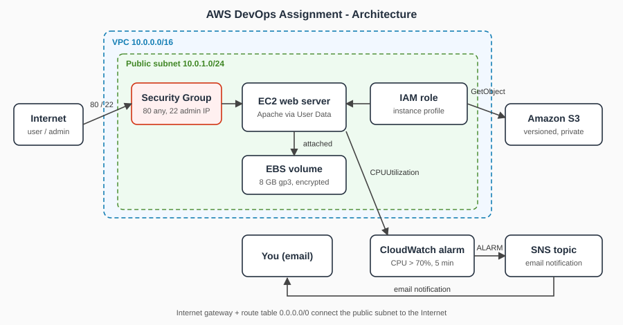

# Architecture

| Component | Purpose | Connects to |
|---|---|---|
| Internet / user | Visits the website (HTTP 80); the administrator uses SSH (22) | Security Group |
| Internet gateway + route table | Gives the public subnet a route to the Internet | VPC |
| Security Group | Stateful firewall: HTTP from anywhere, SSH from the student IP only | EC2 |
| EC2 web server | Amazon Linux 2023 running Apache, installed automatically by User Data | EBS, IAM role |
| EBS volume | Encrypted gp3 root volume (block storage, attached to one instance) | EC2 |
| IAM role (instance profile) | Gives the instance temporary credentials, no access keys on the box | S3, CloudWatch |
| Amazon S3 bucket | Versioned object storage, Block Public Access on | IAM role |
| CloudWatch alarm | `CPUUtilization > 70%` for 5 minutes | SNS |
| SNS topic | Sends the alarm email | Student email |

## Traffic and data flows
1. User -> Internet -> Security Group (port 80) -> EC2 -> web page.
2. Administrator -> Security Group (port 22, student IP only) -> EC2.
3. EC2 -> IAM role credentials -> S3 (read objects).
4. EC2 metrics -> CloudWatch alarm -> SNS -> email.

## S3 vs EBS
S3 is object storage: accessed over HTTPS by key, practically unlimited, versioned and shared across services and Regions. EBS is block storage: a disk attached to one EC2 instance in one Availability Zone, used for the OS and for data needing a file system with low latency.

## EC2 configuration (manual build)

| Configuration | Value |
|---|---|
| Region | us-east-2 (Ohio) |
| Availability Zone | us-east-2b |
| AMI | Amazon Linux 2023 (`ami-0d31a22b09ceec4db`) |
| Instance type | t3.micro (credit specification: standard) |
| VPC | `vpc-03c6dc72cc445c1b0` (default VPC) |
| Subnet | `subnet-005f4c8f7a91f6fc9` |
| Public IP | 18.222.215.226 (temporary, released at cleanup) |
| Security Group | `aws-devops-web-sg` (`sg-0c680bc27f21c8c4e`) |
| Storage | 8 GiB gp3 root volume, encrypted, delete on termination |
| IAM role | `aws-devops-ec2-role` (instance profile) |
| Metadata | IMDSv2 required |
| Web server | Apache installed by User Data (`scripts/user-data.sh`) |

## Diagram note
The diagram shows the design built by CloudFormation (VPC 10.0.0.0/16, public subnet 10.0.1.0/24). The manual build used the account's default VPC (172.31.0.0/16) with the same components: Security Group, EC2 + Apache, encrypted EBS, IAM role (S3 read + CloudWatch agent policy), S3, CloudWatch alarm and SNS. S3, CloudWatch and SNS are regional services and sit outside the VPC. The bucket name contains the AWS account ID, so it is not shown in these docs.
